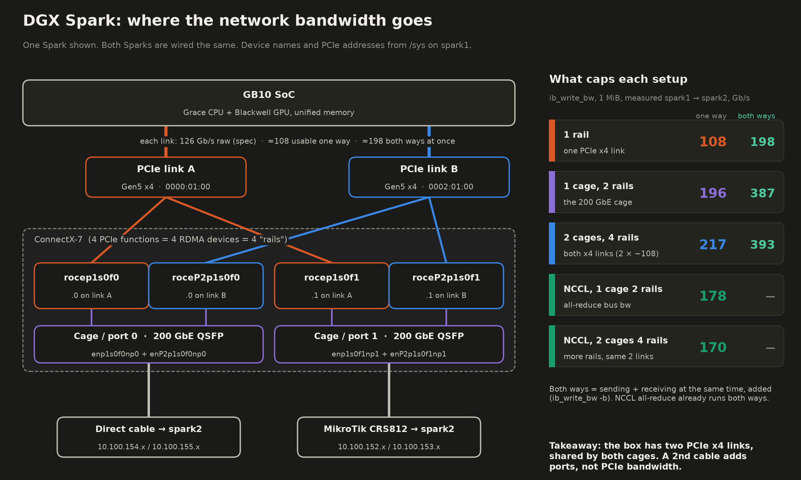
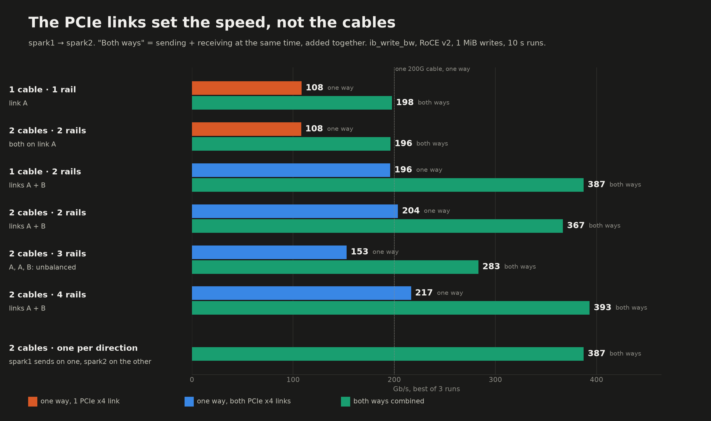
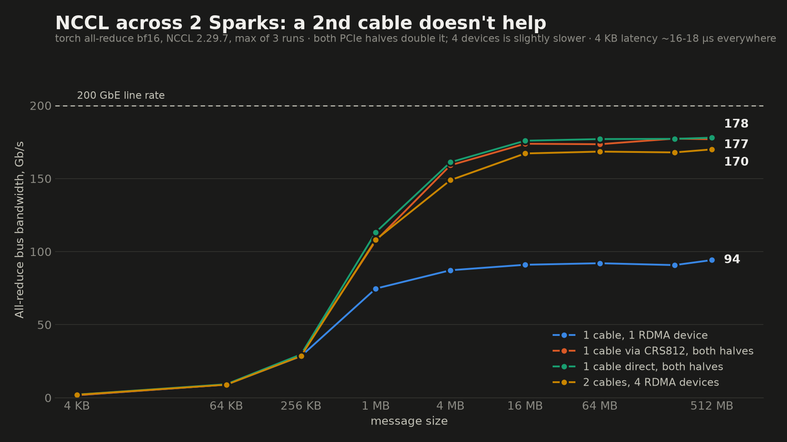
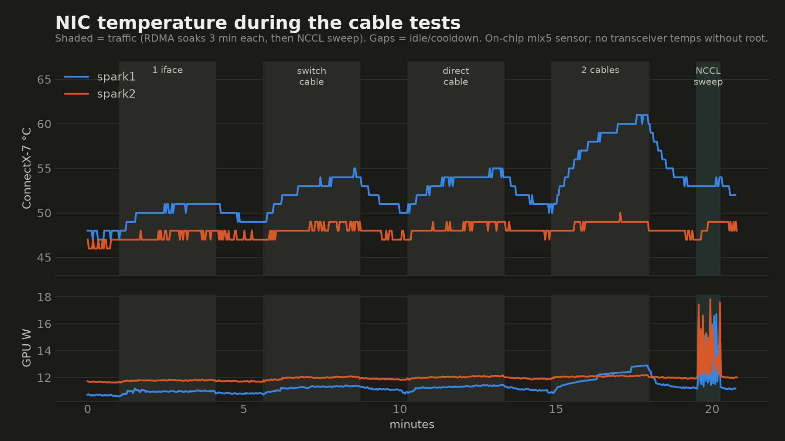
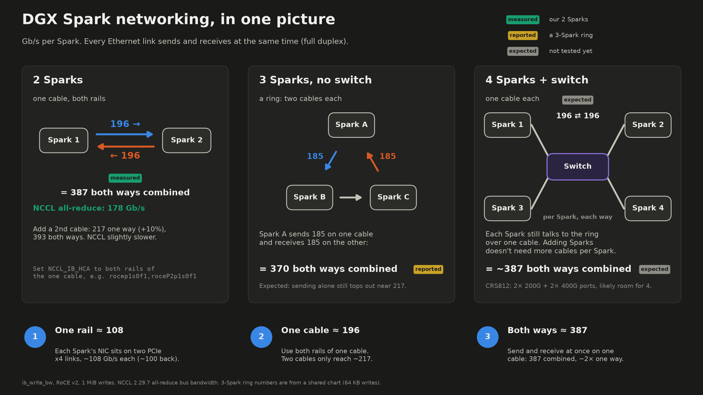

# Does a second cable double DGX Spark bandwidth? What we measured on ConnectX-7

*Two DGX Sparks, one or two QSFP cables, every rail combination in both directions, NCCL, and a thermal detour. October 2026.*

## 1. The question people keep asking

The DGX Spark has two QSFP cages on its ConnectX-7 NIC. So when people connect two Sparks, the next question is almost always the same: if one cable gives about 200 Gb/s, does a second cable give 400?

A [thread by @Tech2Wild](https://x.com/Tech2Wild/status/2111666374032425064) on X made the case that a second cable doubles bandwidth. It is a reasonable reading of the spec sheet, and it got me to test it properly instead of guessing. Thanks to them for the prompt.

I have two Sparks on my desk: `spark1` (spark-4e77) and `spark2` (spark-fa00). Over two days I ran every cable and rail combination I could set up, in both directions and both ways at once, plus NCCL all-reduce and temperature logging.

The short answer:

- **One cable, used correctly, already gives about 196 Gb/s one way.** A second cable adds about 10% (217 Gb/s).
- **In real model work, the second cable changed nothing.** A model split across both Sparks ran at the same speed and the same temperatures with one cable or two (section 8).
- **The limit is PCIe, not the cables.** The NIC reaches the GB10 chip over two PCIe Gen5 x4 links. Each one tops out at about 108 Gb/s one way.
- **"Double" is real if you start from one rail.** One rail gives 108. Two cables with one rail each give 204. That is close to 2×. But one cable with two rails gives 196, so the doubling comes from the second PCIe link, not from the second cable.

The rest of this post explains the hardware, the method, every result, and what I did not test. All numbers come from logs in this repo, and each table names its log file.

## 2. The hardware: one NIC, four functions, two PCIe links

The diagram below shows the path from the chip to the cables on one Spark. Both Sparks are wired the same. The device names and PCIe addresses come from `/sys` on spark1.



From top to bottom:

1. **GB10 SoC.** The Grace CPU and Blackwell GPU share one memory.
2. **Two PCIe Gen5 x4 links.** I call them link A (`0000:01:00`) and link B (`0002:01:00`). By the spec, Gen5 x4 is 4 lanes at 32 GT/s with 128b/130b encoding, about 126 Gb/s raw per direction. That number is spec arithmetic, not a measurement. What I measured is 108.3 Gb/s of RDMA payload per link, one way, on both link A and link B.
3. **The ConnectX-7 exposes four PCIe functions.** Each one is a separate RDMA device. I call each one a "rail":

   | RDMA device | Netdev | Cage | PCIe link |
   |---|---|---|---|
   | `rocep1s0f0` | `enp1s0f0np0` | 0 | A |
   | `roceP2p1s0f0` | `enP2p1s0f0np0` | 0 | B |
   | `rocep1s0f1` | `enp1s0f1np1` | 1 | A |
   | `roceP2p1s0f1` | `enP2p1s0f1np1` | 1 | B |

4. **Two 200 GbE QSFP cages.** Each cage is reachable from both PCIe links. Each physical port therefore shows up as two netdevs and two RDMA devices, one per link.

This is the key point for the whole post. **Both cages share the same two PCIe links.** A second cable adds a port. It does not add a PCIe link.

My cabling:

| Port | Path | spark1 | spark2 |
|---|---|---|---|
| cage 0 (f0) | direct cable | 10.100.154.1 / .155.1 | 10.100.154.2 / .155.2 |
| cage 1 (f1) | via a MikroTik CRS812 switch | 10.100.152.1 / .153.1 | 10.100.152.3 / .153.2 |

Each rail has its own subnet. RoCE v2 over IPv4 is GID index 3 on both machines. Both Sparks run kernel 6.17.0-1029-nvidia.

## 3. Test setup and method

**RDMA bandwidth.** I used `ib_write_bw` from perftest:

- RoCE v2, GID index 3
- 1 MiB messages, 4 queue pairs per stream
- 10-second runs (`-D 10`), Gb/s reported by perftest (payload only)
- One `ib_write_bw` process per rail, all started at the same time; the total is the sum of the per-rail numbers
- "Both ways" adds `-b`: each stream sends and receives at the same time, and perftest reports the sum of both directions
- Best of 3 runs per combination, in each direction

The script is [`bench.sh`](../bench.sh). The rail combinations are in [`rails.sh`](../rails.sh) (`REVERSE=1` for spark2 → spark1) and the duplex tests in [`duplex.sh`](../duplex.sh).

For runs of 60 seconds or longer, `bench.sh` also reads the sender's `port_xmit_data` counter for each rail, 15 seconds after the start and 15 seconds before the planned end. That gives a second, independent rate. It counts bytes on the wire, including packet headers, so it reads about 1.4% higher than perftest's payload number on one cable (198.85 vs 196.08 Gb/s).

One practical snag: perftest versions must match on both ends. spark1 has perftest 6.28 (from DOCA) and spark2 has 6.20 (from Ubuntu). A 6.20 server crashed with "buffer overflow detected" when a 6.28 client connected. I ran spark2's 6.20 binary on both sides to avoid it.

**NCCL.** A two-rank `torch.distributed` all-reduce in bf16, from 4 KB to 512 MB, 3 runs per setup ([`nccl/ar_sweep.py`](../nccl/ar_sweep.py)). It ran in a container with NCCL 2.29.7 and torch 2.13.0+cu130 (printed by the soak script, `results/2026-10-19-heat-fwd/nccl-soak.log`). `NCCL_IB_HCA` chooses which rails NCCL uses. The full environment is in section 6. A separate 3-minute soak ([`nccl/ar_soak.py`](../nccl/ar_soak.py)) repeats one 256 MB all-reduce for the thermal tests.

**Temperatures.** A logger sampled every 2 seconds on both Sparks during 3-minute soaks with 90-second cooldowns. The sensors were the ConnectX-7 on-chip `mlx5` hwmon sensors, the hottest ACPI thermal zone ("SoC" below), and GPU temperature and power. Transceiver temperatures need root (`ethtool -m`), so they are not included.

**Scheduling.** Both Sparks are shared machines, so I made sure no other benchmark ran on either one during these tests.

## 4. Every cable and rail combination

Here is every combination, one way and both ways at once. The chart shows spark1 → spark2. The table adds the other direction.



Gb/s, best of 3 runs:

| Cables | Rails used | PCIe links | One way, spark1 → spark2 | One way, spark2 → spark1 | Both ways |
|---|---|---|---|---|---|
| 1 | 1 (`rocep1s0f0`) | A | 108.33 | 99.63 | 197.71 |
| 1 | 1 (`roceP2p1s0f0`) | B | 108.33 | 99.61 | not run |
| 2 | 2, both on link A (`rocep1s0f0`, `rocep1s0f1`) | A | 108.01 | 99.49 | 196.27 |
| 1 | 2 (`rocep1s0f0`, `roceP2p1s0f0`) | A + B | 196.08 | 196.08 | 387.15 |
| 2 | 2, one per cable (`rocep1s0f0`, `roceP2p1s0f1`) | A + B | 203.75 | 182.00 | 366.77 |
| 2 | 3 (A, B on cage 0; A on cage 1) | A + B, unbalanced | 152.67 | 135.94 | 283.15 |
| 2 | 4 | A + B | 216.60 | 197.72 | 393.16 |
| 2, one cable per direction | 4 | A + B | n/a | n/a | 387.23 (196.07 + 191.16) |

Sources: one way from `results/2026-10-19-rails-oneway-fwd.log` and `results/2026-10-19-rails-oneway-rev.log`; both ways from `results/2026-10-19-rails-bidir.log`; the last row from `results/2026-10-18-rails-duplex.log`. The one-way spark1 → spark2 numbers repeat an earlier run (`results/2026-10-18-rails-duplex.log`) within 0.3%.

An earlier 5-run matrix, spark1 → spark2, also compared the direct cable with the switch (`results/2026-10-18-results.log`):

| Setup | Best Gb/s, one way |
|---|---|
| 1 cable via the CRS812, both PCIe links | 196.08 |
| 1 cable direct, both PCIe links | 196.08 |
| 2 cables, 4 rails | 216.61 |
| 1 cable, 1 rail, direct | 108.33 |
| 1 cable, 1 rail, via the CRS812 | 107.82 |

What the numbers say, using the spark1 → spark2 column:

**One PCIe link is 108.3 Gb/s, no matter how many cables.** One rail gives 108.33 on link A and 108.33 on link B. Two rails on link A, through two different cables, give 108.01 in total (56.52 + 51.49). The second cable added nothing because both rails share the same PCIe link.

**One cable with both links gives 196.** This is `rocep1s0f0` plus `roceP2p1s0f0`: same cage, different PCIe links. Each rail ran at 98.04 Gb/s. The total is just under the 200 GbE line rate of one port. Going through the CRS812 switch or using a direct cable made no difference (196.08 both).

**Two cables with four rails give about 217.** That is 10% more than one cable. The four rails ran at about 55 / 55 / 53 / 53 Gb/s. The sum is close to two PCIe links' worth (2 × 108.3), which is the ceiling.

**Three rails are worse than two.** With rails A and B on cage 0 plus rail A on cage 1, link A carried two streams (43.84 + 64.04 = 107.88, which is link A's full capacity) and link B carried only one (44.79). The total was 152.67, less than one cable with two rails. It looks like the streams on a shared link are throttled together, and the stream alone on link B ends up near the same per-stream rate as its neighbours. I have not confirmed that. The practical lesson: use the rails in balanced pairs, one per PCIe link.

**Two cables with one rail each give 204 one way but only 367 both ways.** One way, this is the best two-rail setup (96.84 + 106.91). Both ways, it is lower than one cable with two rails (366.77 vs 387.15). I have not investigated the cause.

### Reconciling with "a second cable doubles bandwidth"

If you start from one rail, a second cable with its own rail on the other PCIe link takes you from 108 to 204. That really is about 2×, and I think it explains why people see a doubling. The doubling comes from adding the second PCIe link. One cable can reach both PCIe links on its own, and then it gives 196. From there, a second cable adds about 10%.

## 5. Simplex vs duplex: what "387" and "370" mean

Ethernet is full duplex. Every link can send and receive at the same time, at full rate in each direction. That makes it easy to compare two numbers that measure different things:

- **One way (simplex):** how fast one Spark can send to the other.
- **Both ways (duplex), added:** what one Spark sends plus what it receives at the same moment.

The both-ways number is roughly double the one-way number, because the two directions mostly do not compete:

| Setup | One way, spark1 → spark2 | Both ways, added | Ratio |
|---|---|---|---|
| 1 rail | 108.33 | 197.71 | 1.83× |
| 1 cable, 2 rails | 196.08 | 387.15 | 1.97× |
| 2 cables, 4 rails | 216.60 | 393.16 | 1.82× |

Sources: `results/2026-10-19-rails-oneway-fwd.log`, `results/2026-10-19-rails-bidir.log`.

Two details stand out:

1. **One cable already does about 387 both ways.** On the switch cable, `duplex.sh` measured up to 387.28 Gb/s (193.64 per rail, `results/2026-10-18-rails-duplex.log`). Adding a second cable and two more rails moves this to 393.16, which is 1.5% more.
2. **Splitting directions across two cables gives the same total.** With spark1 sending on the direct cable and spark2 sending on the switch cable at the same time, the totals were 196.07 + 191.16 = 387.23. Same as one cable doing both directions.

This matters when you read other people's numbers. A figure like "370 Gb/s" for a Spark in a 3-node ring (section 10) is in plus out, added together. It lines up with the 387 both-ways number above, not with the 196 one-way number. Both numbers are correct. They answer different questions.

The same applies to NCCL. For two ranks, NCCL's bus bandwidth equals algorithm bandwidth: bytes reduced divided by time (see the comment in `ar_sweep.py`). All-reduce sends and receives at the same time, so a bus bandwidth of 178 Gb/s means about 178 Gb/s in each direction. If you added both directions the way the "both ways" column does, it would be about 356 Gb/s. That 356 is my arithmetic, not a measurement.

## 6. NCCL results and the recommended `NCCL_IB_HCA`



Max bus bandwidth over 3 runs and message sizes up to 512 MB. 4 KB latency is the lowest of the 3 runs.

| Setup | `NCCL_IB_HCA` | spark1 as rank 0 | spark2 as rank 0 | 4 KB latency |
|---|---|---|---|---|
| 1 cable, 1 rail | `rocep1s0f1` | 11.78 GB/s (94.2 Gb/s) | 11.71 GB/s (93.7 Gb/s) | 18.3 µs |
| 1 cable via CRS812, 2 rails | `rocep1s0f1,roceP2p1s0f1` | 22.17 GB/s (177.4 Gb/s) | 22.11 GB/s (176.9 Gb/s) | 17.8–18.3 µs |
| 1 cable direct, 2 rails | `rocep1s0f0,roceP2p1s0f0` | 22.25 GB/s (178.0 Gb/s) | 22.34 GB/s (178.7 Gb/s) | 15.5–15.6 µs |
| 2 cables, 4 rails | all four | 21.25 GB/s (170.0 Gb/s) | 21.23 GB/s (169.8 Gb/s) | 15.5–16.0 µs |

Sources: `results/2026-10-18-thermal/nccl-results.log` (spark1 as rank 0) and `results/2026-10-18-thermal-reverse/nccl-results.log` (spark2 as rank 0).

Over a sustained 3-minute run of 256 MB all-reduces on the switch cable with both rails, bus bandwidth held at 21.90 GB/s (175.2 Gb/s) with spark1 as rank 0 and 21.97 GB/s (175.8 Gb/s) with spark2 as rank 0 (`results/2026-10-19-heat-fwd/nccl-soak.log`, `results/2026-10-19-heat-rev/nccl-soak.log`).

What this shows:

- **Listing both rails of one cable roughly doubles NCCL bandwidth** compared to one rail: from about 94 to about 178 Gb/s.
- **A second cable does not help NCCL.** With all four rails, bus bandwidth was slightly lower (about 170).
- **The direct cable has about 2–3 µs lower small-message latency** than the path through the switch (about 16 vs 18 µs at 4 KB).
- **The two directions match** within about 1%. The RDMA direction asymmetry in section 9 does not show up here.

Here is the environment I used for these numbers, from [`nccl/run_rank.sh`](../nccl/run_rank.sh). Only this combination was tested. `NCCL_IB_HCA` is the line that matters most, but I can't say how much each of the other settings contributes.

```bash
NCCL_IB_HCA=rocep1s0f1,roceP2p1s0f1   # both rails of the cable in cage 1
# or: NCCL_IB_HCA=rocep1s0f0,roceP2p1s0f0 for the cable in cage 0
NCCL_IB_DISABLE=0
NCCL_NET=IB
NCCL_NET_PLUGIN=none
NCCL_IB_ROCE_VERSION_NUM=2
NCCL_IB_GID_INDEX=3
NCCL_IB_MERGE_NICS=0
NCCL_MAX_NCHANNELS=8
NCCL_BUFFSIZE=1048576
NCCL_PROTO=^LL128
NCCL_SOCKET_IFNAME=enp1s0f1np1
```

The common mistake is to set `NCCL_IB_HCA` to a single device, such as `rocep1s0f1`. That uses one PCIe link and caps you at about half the bandwidth, whether one or two cables are plugged in.

## 7. Thermals: the perftest heat came from the benchmark, not the NIC

The first thermal run looked worrying. During 3-minute `ib_write_bw` soaks, the sender heated up a lot and the receiver barely moved.



Peak temperatures during each 3-minute soak in that first run, spark1 sending (`results/2026-10-18-thermal/`, computed from `temps-*.csv` and `phases.csv`):

| Soak | spark1 SoC (sender) | spark1 NIC | spark2 SoC (receiver) | spark2 NIC |
|---|---|---|---|---|
| idle | 43.8 °C | 48 °C | 43.8 °C | 47 °C |
| 1 rail | 60.8 °C | 51 °C | 44.7 °C | 48 °C |
| 1 cable via switch, 2 rails | 65.5 °C | 55 °C | 45.7 °C | 49 °C |
| 1 cable direct, 2 rails | 65.0 °C | 55 °C | 45.7 °C | 49 °C |
| 2 cables, 4 rails | 78.7 °C | 61 °C | 46.5 °C | 50 °C |

The NIC sensor on the sender reached 61 °C with two cables and was still climbing near the end of the 3 minutes. It was tempting to conclude that two cables make the NIC run hot.

The pattern pointed somewhere else. The heat followed the sender, and it grew with the number of rails. That is also the number of `ib_write_bw` client processes. perftest's `ib_write_bw` busy-polls its completion queue. Each stream keeps one CPU core spinning at 100% for the whole run.

So I ran a heat-source test ([`thermal/heat_source.sh`](../thermal/heat_source.sh)), once with each Spark as the sender. It compares four things at the same traffic level:

1. **Busy-poll:** `ib_write_bw`, as before.
2. **Event mode:** `ib_send_bw -e` with the same rails. The process sleeps until the NIC signals a completion instead of spinning. perftest 6.20's `ib_write_bw` has no event mode, so this uses send instead of write.
3. **CPU spin, no traffic:** four shell loops spinning on the sender for 3 minutes. No network traffic at all.
4. **NCCL:** a 3-minute all-reduce soak on one cable with both rails.

Peak temperatures on the sender (for NCCL, on both Sparks), with the measured rate for each soak:

| Soak | spark1 sends: rate | SoC max | NIC max | spark2 sends: rate | SoC max | NIC max |
|---|---|---|---|---|---|---|
| idle | — | 46.0 °C | 50 °C | — | 46.8 °C | 51 °C |
| 1 cable, 2 rails, busy-poll | 196.08 | 65.0 °C | 55 °C | 196.08 | 66.9 °C | 54 °C |
| 1 cable, 2 rails, event mode | 196.07 | 47.7 °C | 52 °C | 196.08 | 46.7 °C | 50 °C |
| 2 cables, 4 rails, busy-poll | 216.57 | 78.4 °C | 60 °C | 197.62 | 81.9 °C | 54 °C |
| 2 cables, 4 rails, event mode | 218.25 | 48.9 °C | 53 °C | 197.65 | 46.7 °C | 50 °C |
| 4 spinning cores, no traffic | 0 | 74.2 °C | 58 °C | 0 | 73.4 °C | 55 °C |
| NCCL soak, spark1 / spark2 | 175.2 | 69.4 / 67.0 °C | 60 / 57 °C | 175.8 | 69.0 / 67.3 °C | 59 / 58 °C |

Rates are perftest Gb/s (NCCL: bus bandwidth). The port counters agree: in each direction, busy-poll and event mode moved the same bytes on the wire (198.85 Gb/s on one cable; 223.88 and 200.43 Gb/s on four rails). Sources: `results/2026-10-19-heat-fwd/` and `results/2026-10-19-heat-rev/` (`soak-results.log`, `nccl-soak.log`, and temperatures computed from `temps-*.csv` and `phases.csv`).

The result held in both directions:

- **Four spinning cores with no network traffic** heated the SoC almost as much (73–74 °C) as four busy-polling RDMA streams (78–82 °C).
- **The same traffic in event mode** stayed within 3 °C of idle on the SoC and the NIC sensor, at the full rate.
- **The NIC sensor follows the SoC.** It reached 55–58 °C during the CPU spin, with no traffic. So a rising NIC temperature here mostly reflects heat from the chip next to it, not NIC work.
- **The receiver stayed close to idle** during every perftest soak (48.7 °C SoC at most). In the first reversed run, the receiver once peaked at 54.8 °C during an event-mode soak (`results/2026-10-18-thermal-reverse/`). The repeat runs did not show that.

**NCCL is different: it heats both Sparks.** During the 3-minute NCCL soak, both Sparks reached 67–69 °C SoC and 57–60 °C on the NIC sensor, and GPU power rose from about 11–12 W to about 20–21 W. All-reduce is symmetric, so both ends do the same work. NCCL runs a CPU proxy thread that polls for network completions, and the GPU runs the reduction kernels. I did not separate the two, so I can't say how much of this heat comes from each.

My conclusion: moving about 200 Gb/s through the ConnectX-7 by itself adds at most about 3 °C on the sender. The large temperature rise in the first run came from perftest spinning one core per stream. A real NCCL workload does add heat, on both machines, at about the level of busy-polling one cable.

Both cables were plugged in for every run. I did not measure the idle heat of a second cable or transceiver sitting in a cage.

## 8. Real model work: one cable vs two cables

Synthetic soaks are one thing. I also wanted to know what a second cable does for an actual model split across both Sparks. So I served the same model twice and changed one setting between the runs.

**Setup.** Qwen3.8-Flash-Next (125B-A5B, INT4) with tensor parallelism across both Sparks (TP=2), served by vLLM (`qwen38-flash-next-cluster-recipe`, image `myllmbox/qwen38-flash-next-cluster-vllm:v5.2`). The script is [`thermal/model_heat.sh`](../thermal/model_heat.sh). I started the model, let it sit idle for 3 minutes, then sent it the same set of requests in a loop for 15 minutes: streamed OpenAI-API chat requests with 1k- and 8k-token prompts and 512 output tokens each, plus a batch of 4 requests at once to measure combined decode speed. That gave 21 iterations for setup A and 22 for setup B. Only `NCCL_IB_HCA` changed:

- **A:** `rocep1s0f1,roceP2p1s0f1`: one cable, both rails
- **B:** all four rails across two cables

Temperatures are over the 15-minute load window. Speeds are medians over all iterations.

| | A: 1 cable, 2 rails | B: 2 cables, 4 rails |
|---|---|---|
| spark1 SoC, peak / mean | 92.6 / 81.7 °C | 93.5 / 81.8 °C |
| spark1 NIC, peak / mean | 69 / 65.6 °C | 70 / 65.9 °C |
| spark2 SoC, peak / mean | 92.7 / 77.3 °C | 92.5 / 78.0 °C |
| spark2 NIC, peak / mean | 66 / 63.0 °C | 66 / 63.5 °C |
| GPU power, mean (each Spark) | 40.0 / 40.5 W | 39.8 / 40.6 W |
| Decode, 4 streams aggregate | 186.0 tok/s | 181.3 tok/s |
| Decode, 1 stream, 8k prompt | 79.1 tok/s | 81.6 tok/s |
| Prefill, 8k prompt | 4,283 tok/s | 4,280 tok/s |
| Time to first token, 8k prompt | 1.93 s | 1.93 s |

Sources: `results/2026-10-19-model-heat/` (`temps-*.csv`, `phases.csv`, `rdma-counters.csv`, `run.log`) and the per-iteration speed results in `load-A.csv` and `load-B.csv` in the same folder (raw localeval output for all 43 iterations in `localeval/`).

**There is no difference beyond run-to-run noise.** The temperatures match within about 1 °C. The decode numbers move a little in both directions, and they vary more between iterations of the same setup than between setups. For example, the 4-stream aggregate ranged from 161.9 to 197.1 tok/s across A's iterations and from 156.7 to 193.3 across B's.

The reason is simple: this workload barely uses the network. Over the load window, the port counters show about 3.9 Gb/s each way on average. That is about 2% of what one cable can carry. Setup B did spread those bytes over all four rails. But the recipe uses its own RoCE all-reduce for messages up to 2 MB, which covers decode, and that code opened only the first two devices (`rocep1s0f1,roceP2p1s0f1`) in both setups (`run.log`). Only NCCL, which handles messages above 2 MB, used all four rails in setup B.

The heat under load comes from compute. Before the model was loaded, the SoC sat at about 42–44 °C on average. Under load it peaked at about 92–93 °C on both Sparks, with the GPU drawing about 40 W on average. Neither the cables nor the rail count changed that.

This closes the question the synthetic soaks left open. The big temperature differences between one and two cables in section 7 came from perftest busy-polling. In real model work, I could not measure any difference.

## 9. Direction asymmetry: spark2 → spark1 caps lower per PCIe link

The rail matrix in section 4 ran in both directions with identical settings. Most combinations differ:

| Setup | spark1 → spark2 | spark2 → spark1 | Difference |
|---|---|---|---|
| 1 rail, link A | 108.33 | 99.63 | −8.0% |
| 1 rail, link B | 108.33 | 99.61 | −8.0% |
| 2 rails, both on link A | 108.01 | 99.49 | −7.9% |
| 1 cable, 2 rails (A + B) | 196.08 | 196.08 | 0% |
| 2 cables, 1 rail each (A + B) | 203.75 | 182.00 | −10.7% |
| 2 cables, 3 rails | 152.67 | 135.94 | −11.0% |
| 2 cables, 4 rails | 216.60 | 197.72 | −8.7% |

Sources: `results/2026-10-19-rails-oneway-fwd.log`, `results/2026-10-19-rails-oneway-rev.log`. Best of 3 runs each; the 3 runs in each row were within 0.7% of each other.

The pattern is consistent. When spark2 sends to spark1, each PCIe link tops out at about 99.6 Gb/s instead of 108.3. Every setup that hits the per-link ceiling shows it. The one setup that doesn't is one cable with two rails: there, each rail is limited to 98.04 Gb/s by the 200 GbE port, which is below both ceilings. That is the setup I recommend, so the asymmetry does not affect it.

With four rails in the slow direction, each rail ran at 49.4 Gb/s, so each link carried 98.8. The 180-second soaks in section 7 show the same thing (197.62 vs 216.57).

I have not found the cause. Both Sparks run the same kernel (6.17.0-1029-nvidia) and the same perftest binary. The test does not show which end sets the limit: spark2 reading from its memory over PCIe, or spark1 writing into its memory. One difference I know of is that spark1 has NVIDIA's DOCA packages installed and spark2 uses Ubuntu's. I have not tested whether that matters.

NCCL showed no asymmetry: the two directions were within about 1% (section 6).

## 10. Scaling to 3 or 4 Sparks

Most people asking about cables are really planning for more than two Sparks. I have only two, so this section separates what I measured from what others reported and what I expect.



**2 Sparks (measured).** One cable with both rails: 196 Gb/s each way, 387 both ways added. NCCL all-reduce: about 178 Gb/s bus bandwidth.

**3 Sparks in a ring, no switch (reported, not measured by me).** @Tech2Wild shared a chart from a 3-Spark ring: each Spark uses one cable to its left neighbor and one to its right. They reported about 185 Gb/s per direction per Spark, so about 370 Gb/s in and out added. Those numbers used 64 KB writes, while mine used 1 MiB, so they are not directly comparable. Still, they fit the picture from section 5. Each Spark sends 185 on one cable and receives 185 on the other, which adds to 370. That is close to my 387 both-ways number on a single cable. I would expect a ring Spark that only sends to still top out near 217, because the two PCIe links are the same.

**4 Sparks with a switch (expected, not tested).** Each Spark connects to the switch with one cable and uses both rails. Based on my two-Spark numbers, I expect about 196 Gb/s each way per Spark and about 387 both ways, as long as the switch is not the bottleneck. According to its spec sheet, my MikroTik CRS812 has two 200G ports and two 400G ports, so it likely has room for four Sparks, but I have not tried it. The switch path performed the same as a direct cable in every two-Spark bandwidth test (196.08 vs 196.08).

The main takeaway for scaling: adding Sparks does not require more cables per Spark for bandwidth. One cable per Spark already reaches about 90% of what the PCIe links can carry.

## 11. Practical recommendations

1. **Use one cable and both rails.** Use `rocep1s0f0` + `roceP2p1s0f0` (cage 0) or `rocep1s0f1` + `roceP2p1s0f1` (cage 1). That gives 196 Gb/s one way in both directions and about 387 both ways.
2. **Set `NCCL_IB_HCA` to both rails of that cable.** A single device caps NCCL at about 94 Gb/s. Both rails gave about 178 in my tests.
3. **Don't expect a second cable to double bandwidth.** It added about 10% one way (217 vs 196), 1.5% both ways (393 vs 387), and nothing for NCCL (170 vs 178).
4. **If you use two cables, use the rails in balanced pairs**, one per PCIe link. Two rails on the same link cap at 108. Three rails (two on one link) gave 153.
5. **Don't judge NIC heat with busy-polling benchmarks.** perftest spins one CPU core per stream. Use event mode (`-e`) when you care about temperatures. In real model work, the heat comes from compute, and a second cable did not change it.
6. **A direct cable and a switch give the same bandwidth.** The direct cable had about 2–3 µs lower small-message NCCL latency.
7. **For TP=2 inference, one cable is enough.** In my model test, two cables gave the same speed and temperatures, because the model used about 2% of one cable.
8. **Match perftest versions on both ends.** A 6.20 server crashed when a 6.28 client connected.

## 12. Open questions and what I did not test

- **The cause of the spark2 → spark1 per-link cap** (99.6 vs 108.3 Gb/s), and whether it is in the sending or the receiving Spark.
- **Why two cables with one rail each give only 367 both ways**, while one cable with two rails gives 387.
- **How streams share a link** in the three-rail test, and why the lone stream on link B stays near 45 Gb/s.
- **Port counters vs perftest on four rails.** On one cable, the wire counters read 1.4% above perftest's payload rate, which matches header overhead. With four rails spark1 → spark2, the two cage-1 rails read about 5% above (56.08 vs 53.19). Retransmissions are one possible reason. I have not checked.
- **Where the NCCL soak's heat comes from:** the CPU proxy thread or the GPU kernels.
- **The idle heat of a second cable or transceiver.** Both cables stayed plugged in for every run. Transceiver temperatures need root and were not logged.
- **3 and 4 Sparks.** The ring numbers in section 10 are from @Tech2Wild's chart, and the switch numbers are my expectation. I have not run either setup.
- **Message sizes.** All RDMA numbers use 1 MiB writes. I did not sweep RDMA message sizes.
- **Other workloads.** I tested one real workload: TP=2 inference of one model with one recipe (section 8). I did not test training, larger batches, or workloads that move more data between the Sparks. Those could use the network much more than 2% of one cable.

If you have a third Spark or a 4-Spark switch setup and can run the same scripts, I would be glad to compare notes. All the scripts, raw logs and charts are in this repo.
